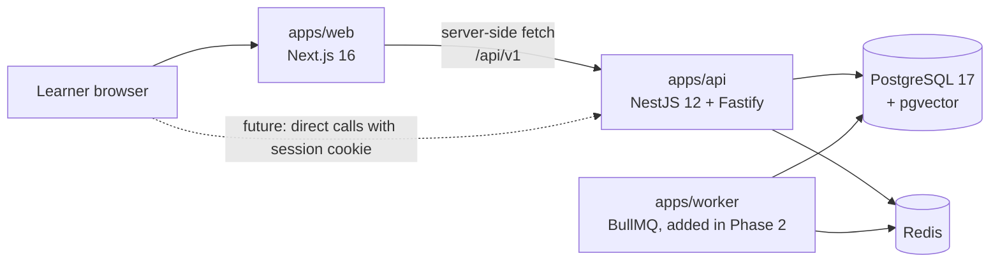

# System overview

See ADR-001 for why this is a modular monolith.

## Containers

| Container    | Code                                     | Runs as               | Production target                           |
| ------------ | ---------------------------------------- | --------------------- | ------------------------------------------- |
| Web          | `apps/web`                               | `next start`          | Managed Next.js hosting or a container      |
| API          | `apps/api`                               | `node dist/main.js`   | Managed container service                   |
| Worker       | `apps/worker` (not yet created)          | Separate Node process | Same container service, separate deployment |
| Database     | `packages/database` (schema, migrations) | PostgreSQL            | Managed PostgreSQL with backups and PITR    |
| Cache/queues | n/a                                      | Redis                 | Managed Redis-compatible service            |

Locally, `docker-compose.yml` provides PostgreSQL and Redis, bound to `127.0.0.1` only.

## API foundation (Phase 1)

- **Prefix:** every route is under `/api/v1`.
- **Configuration:** `apps/api/src/config/env.schema.ts` validates every variable with Zod at startup. A missing or invalid value stops the process with a message naming the variable and never its value.
- **Request IDs:** each request gets an ID (`req_<32 hex>`), or reuses a safe incoming `x-request-id`. It appears in every log line, in the `x-request-id` response header and in error bodies.
- **Errors:** `AllExceptionsFilter` turns every error into the shared envelope (`@luminai/contracts`). 5xx responses never include the underlying message; details are logged server-side with the request ID.
- **Security headers:** Helmet with a `default-src 'none'` CSP, since the API returns JSON only.
- **CORS:** exactly `WEB_URL`, with credentials enabled for the session cookies coming in Phase 2.
- **Health:** `GET /api/v1/health/live` (process is up, touches nothing) and `GET /api/v1/health/ready` (database `SELECT 1` and Redis `PING`, each with a timeout; 200 when ready, 503 when degraded, no connection details).
- **Shutdown:** Nest shutdown hooks close the HTTP server, then disconnect Prisma and Redis.
- **Logs:** structured JSON from Fastify's logger (pino) at `LOG_LEVEL`.

## Web foundation (Phase 1)

- App Router with Cache Components. Pages render on the server by default; Client Components are used only for the theme toggle and mobile menu.
- Server-only settings (`API_URL`) live in `src/lib/server-env.ts`, which imports `server-only` so a client import fails the build.
- Design tokens are CSS variables mapped to Tailwind 4 theme names (see `docs/design-system/tokens.md`).
